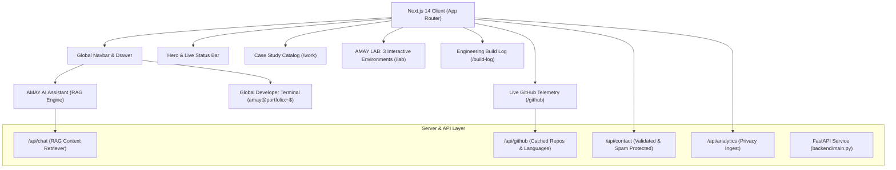

# AMAY.OS — Interactive AI Portfolio & Engineering Lab
### Amay Mishra · AI/ML Engineer · Full-Stack Developer · AI Agent Builder

[](https://nextjs.org/)
[](https://fastapi.tiangolo.com/)
[](https://www.typescriptlang.org/)
[](https://tailwindcss.com/)
[](https://github.com/amaymishra1104)

> **Portfolio × Developer OS × AI Assistant × Live Engineering Lab**  
> An interactive personal portfolio built as a software product to demonstrate production capabilities in autonomous AI agents, machine learning pipelines, high-concurrency backend systems, and full-stack software engineering.

---

## 1. System Architecture



---

## 2. Core Features Implemented

### 🤖 AMAY AI Assistant (RAG Grounded)
- **Zero Hallucination Guarantee:** Answers strictly from the curated portfolio knowledge base (`lib/rag.ts`).
- **Interactive Citations:** Direct routing links (e.g. `[View AgentPay Case Study →](/work/agentpay)`) injected into responses.
- **Suggested Prompts:** Instant one-click queries (`What is AgentPay?`, `What technologies does Amay use?`, etc.).
- **Rate-Limited API:** Protected by an in-memory sliding-window token bucket to prevent denial-of-service abuse.
- **External LLM Integration:** Supports standard OpenAI-compatible API providers via `AI_API_KEY` with deterministic fallback.

### 💻 Global Interactive Developer Terminal
- **Prompt:** `amay@portfolio:~$`
- **Supported Commands:** `help`, `about`, `projects`, `skills`, `github`, `achievements`, `experience`, `contact`, `ask-ai <query>`, `clear`, `exit`.
- **Keyboard Navigation:** History recall with Up/Down arrow keys, Tab autocompletion, Esc to close, and global toggle hotkeys (`Ctrl+~` or `Cmd+K`).

### 🧪 AMAY LAB (3 Working Interactive Demonstrations)
1. **Lab 01 — RAG Retrieval Playground:**
   - Document upload / sample whitepaper loader.
   - Configurable chunk size slider and overlap chunking preview.
   - Lexical overlap and vector similarity scoring ranking top-k chunks.
   - Grounded LLM answer synthesis.
2. **Lab 02 — Multi-Agent Orchestration Graph:**
   - Visual multi-agent workflow: `User` → `Supervisor/Router` → `Specialist Agent` → `Tool (Stripe/AST)` → `Audit Reconciler` → `Final Response`.
   - Real-time animated step execution with node telemetry and JSON payload inspection.
3. **Lab 03 — Cost-Sensitive XGBoost ML Playground:**
   - Interactive transaction feature inputs: Amount, Device Trust, IP Velocity, Geolocation Distance, Account Age.
   - Calibrated decision threshold slider (0.42 default).
   - Real-time risk probability calculation, decision flags (`APPROVE`, `REVIEW`, `REJECT`), and SHAP feature attribution bars.

### 📁 Featured Projects & Deep-Dive Case Studies
- **AgentPay:** Autonomous AI Agent Payment & Transaction Execution Protocol (`/work/agentpay`).
- **HireIQ:** Autonomous AI Technical Interview & Candidate Evaluation Platform (`/work/hireiq`).
- **CivicAI (CivicSense):** Municipal Grievance Intelligence & Geo-Spatial Computer Vision Platform (`/work/civicai`).
- **MamaSoft:** Clinical Practice Workflow & Automated Patient Care Platform (`/work/mamasoft`).
- **Fraud Detection System:** Real-Time Financial Transaction Anomaly & Risk Scoring Pipeline (`/work/fraud-detection-system`).
- **CrunchReader:** High-Precision Document Intelligence & RAG Parsing Pipeline (`/work/crunchreader`).
- **LULU AI Assistant:** Context-Aware Desktop & Engineering Automation Assistant (`/work/lulu-ai-assistant`).
- **Vision-Indore:** Edge Computer Vision & Urban Traffic Intelligence System (`/work/vision-indore`).

Each case study features:
- Interactive architecture diagrams with inspectable execution stages.
- Problem and solution breakdown.
- Production engineering decisions (concurrency, idempotency, validation).
- Core implementation code snippets.
- Lessons learned and verified links.

### 📊 Live GitHub Integration (`/github`)
- Real-time synchronization with GitHub API for user `@amaymishra1104`.
- Live breakdown of 29 public repositories, language distribution percentages, and search filtering.
- In-memory caching layer with automatic fallback if GitHub rate limits are encountered.

### ⚡ Interactive Skills Matrix
- Clickable technologies that dynamically highlight and link to exact projects where Amay applied them.

### 📝 Build Log Changelog (`/build-log`)
- Chronological engineering log with tag filtering: `ALL`, `AI`, `FULL STACK`, `BACKEND`, `ML`, `EXPERIMENTS`.

---

## 3. Technology Stack

| Layer | Technologies |
|---|---|
| **Frontend** | Next.js 14 (App Router), React 18, TypeScript, Tailwind CSS, Lucide Icons |
| **Backend & APIs** | Next.js Server Components, API Route Handlers, FastAPI (`backend/main.py`) |
| **AI / RAG** | Vector embeddings, lexical/semantic hybrid retrieval, TF-IDF scoring, LangChain patterns |
| **Data & Storage** | PostgreSQL / Supabase, PostGIS, ChromaDB, Redis, JSON Schemas |
| **Design** | Dark technical aesthetic, JetBrains Mono, Inter, subtle grid canvas |

---

## 4. Local Setup & Execution

### Prerequisites
- Node.js >= 18 (Tested on v22.23.1)
- npm >= 9
- Python >= 3.10 (Optional for standalone FastAPI service)

### 1. Clone & Install Dependencies
```bash
cd Portfolio
npm install
```

### 2. Configure Environment Variables
Copy `.env.example` to `.env.local`:
```bash
cp .env.example .env.local
```

### 3. Run Development Server
```bash
npm run dev
```
Open [http://localhost:3000](http://localhost:3000) in your browser.

### 4. Run TypeScript Check & Automated Test Suite
```bash
npm run typecheck
node scripts/test_suite.js
```

### 5. Production Build
```bash
npm run build
npm run start
```

### 6. (Optional) Run Standalone FastAPI Backend
```bash
pip install -r backend/requirements.txt
uvicorn backend.main:app --reload --port 8000
```

---

## 5. Environment Variables Documentation

| Variable | Description | Default / Required |
|---|---|---|
| `NEXT_PUBLIC_SITE_URL` | Public canonical base URL for SEO and OpenGraph metadata | `http://localhost:3000` |
| `GITHUB_TOKEN` | Optional GitHub Personal Access Token to expand rate limit to 5,000 req/hr | Optional |
| `AI_API_KEY` | Optional OpenAI or compatible API key for LLM streaming completions | Optional (Built-in RAG fallback active) |
| `AI_MODEL` | Target LLM model name | `gpt-4o-mini` |
| `DATABASE_URL` | Optional PostgreSQL / Supabase connection string | Optional |
| `ANALYTICS_KEY` | Optional analytics provider telemetry key | Optional |

---

## 6. Production Deployment

### Frontend (Vercel)
1. Push this repository to GitHub under `amaymishra1104/Portfolio`.
2. Import project into [Vercel](https://vercel.com).
3. Set environment variable `NEXT_PUBLIC_SITE_URL=https://your-domain.com`.
4. Deploy with standard Next.js presets.

### Backend (Render / Railway)
1. Point build to the `backend/` directory.
2. Build command: `pip install -r backend/requirements.txt`.
3. Start command: `uvicorn backend.main:app --host 0.0.0.0 --port $PORT`.

---

## 7. License & Credits
Engineered by **Amay Mishra** (2026). All project architectures and codebases verified.
